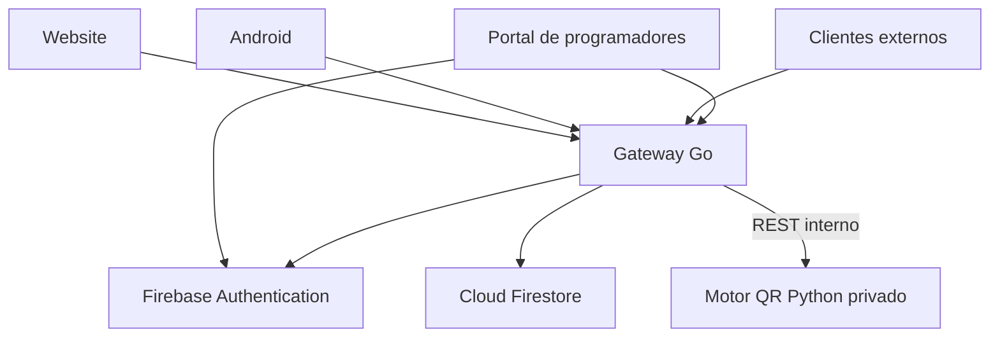

# Gen QR - GQR


[](https://github.com/elrayn96/qrcode_generator/actions/workflows/validacao-python.yml)
[](https://github.com/elrayn96/qrcode_generator/actions/workflows/validacao-go.yml)
[](https://github.com/elrayn96/qrcode_generator/actions/workflows/validacao-documentacao.yml)


> Geração e personalização gratuita de códigos QR estáticos, sem redireccionamentos proprietários.

**Estado:** pré-MVP - arquitectura definida; documentação v0.1 publicada para revisão. A implementação, os serviços executáveis e os contratos OpenAPI completos ainda estão pendentes.

## Visão e objectivos

O GQR é um projecto pessoal de engenharia de software que reúne um website, uma aplicação Android, um portal de programadores e uma API REST pública. Pretende proporcionar uma experiência de criação de códigos QR simples, moderna e acessível, ao mesmo tempo que permite aprofundar conhecimentos de arquitectura, concorrência em Go, segurança de APIs, desenvolvimento multiplataforma e integração contínua.

Os códigos incorporam directamente o conteúdo original, sem marcas de água nem expiração imposta pelo GQR. A disponibilidade de um URL depende do destino original. Alterar o conteúdo exige gerar um novo código. O alojamento público não é obrigatório para a conclusão do projecto.

## Funcionalidades previstas (MVP)

- [ ] URL, texto, Wi-Fi, contactos vCard, email, SMS, telefone e localização.
- [ ] Personalização de módulos, olhos, fundo, cores sólidas, gradientes e logótipos.
- [ ] Selector visual de cores por arrasto, HEX, RGB e HSV, com pré-visualização.
- [ ] Modelos reutilizáveis, margens e preservação dos padrões funcionais do QR.
- [ ] Exportação PNG e SVG e validação por descodificação independente.
- [ ] Histórico local, edição e eliminação sem conta obrigatória.
- [ ] Temas claro, escuro e automático, independentes das cores do QR.
- [ ] Portal com login Google, registo de aplicações, gestão de credenciais, permissões e utilização.
- [ ] API REST versionada, gratuita, sujeita a quotas e limites de frequência.

QR dinâmico, sincronização do histórico, SDKs, gRPC, atestação completa, Docker, leitura QR pelo utilizador e PDF não fazem parte do MVP inicial.

## Arquitectura



O gateway é a única entrada da API. O motor Python recebe pedidos internos e gera as imagens; não fica directamente exposto aos consumidores. A geração é centralizada no servidor, mas o histórico e as preferências permanecem no dispositivo. O Firebase guarda identidade e metadados, nunca os conteúdos dos códigos gerados.

| Componente | Tecnologia definida |
|---|---|
| Website e portal | HTML5, CSS3 e JavaScript puro (ES Modules) |
| Android | Kotlin, Jetpack Compose, Material 3 |
| Gateway | Go, net/http, sem framework externo de routing |
| Motor QR | Python, FastAPI, Uvicorn, Segno, Pillow |
| SVG | Biblioteca padrão Python |
| Identidade | Firebase Authentication com Google |
| Persistência | Cloud Firestore; IndexedDB no website; armazenamento privado no Android |
| Comunicação | REST, HTTP/JSON, OpenAPI |
| CI/CD | GitHub Actions |

O descodificador independente de QR ainda será seleccionado. Docker e alojamento ficam para avaliação posterior.

## API e segurança

A API pública terá versão inicial `/v1`. Os contratos e exemplos executáveis serão definidos na fase de especificação OpenAPI; consultar [API](docs/api/README.md). Não existe ainda um endpoint público disponível.

| Cliente | Modelo de acesso previsto |
|---|---|
| Website e Android oficiais | Sem login obrigatório; identificação pública e limites anónimos |
| Website externo | Chave pública `qr_pk_`, origens autorizadas, permissões e quotas |
| Android externo | Chave pública e identificação declarada; não constitui atestação |
| Backend externo | Chave privada `qr_sk_`, permissões e restrição opcional de IP |
| Portal | Firebase ID Token e autorização por propriedade |

Chaves públicas identificam aplicações, mas não comprovam a origem de pedidos fora do navegador. CORS não substitui autenticação. Chaves privadas nunca serão incorporadas em JavaScript ou APK; serão armazenadas mediante hash seguro ou HMAC e apresentadas uma única vez na criação. Operações administrativas exigem autenticação do programador.

HTTPS será obrigatório fora do ambiente local isolado. Serão aplicados limites de entradas, imagens e resolução; validação de ficheiros enviados; protecção contra SSRF; revogação de credenciais e logs sem segredos ou conteúdos QR. Não serão persistidos conteúdos QR ou logótipos no servidor.

## Concorrência e gestão de recursos

Go gere pedidos simultâneos com goroutines, channels, worker pool limitado, cancelamento por context e encerramento controlado. A fila limitada evita saturação do motor Python. A cache em memória terá capacidade limitada, TTL e invalidação na alteração ou revogação de credenciais. O algoritmo Token Bucket limita frequência; quotas diárias persistentes no Firestore serão reservadas atomicamente.

Parâmetros iniciais propostos: 2 workers, fila de 8 pedidos, timeout total de 15 segundos e TTL de 60 segundos. São valores configuráveis, sujeitos a testes de carga. A arquitectura inicial assume uma instância do gateway; fila cheia retorna 503 e limites de utilização retornam 429.

## Experiência de utilização e internacionalização

A identidade visual segue o conceito B: índigo e violeta, componentes arredondados, gradientes moderados e suporte aos temas claro, escuro e automático. A paleta definitiva será formalizada no sistema de design.

A Lei de Jakob orienta a navegação: padrões familiares, barra inferior Android, acção de criação destacada, gestos horizontais entre abas relacionadas e actualização por arrasto quando aplicável. Os gestos têm alternativas visíveis e não devem interferir com a navegação nativa.

A acessibilidade toma WCAG 2.2 AA como referência web: contraste, textos legíveis e escaláveis, alvos de toque adequados, navegação por teclado, suporte a leitores de ecrã e movimento reduzido. As cores do QR são independentes do tema da interface; contraste visual não substitui testes de descodificação.

O Português é o idioma inicial. Textos de interface ficam em catálogos de tradução; identificadores técnicos e códigos de erro permanecem estáveis. Recursos visuais locais evitam dependências desnecessárias de CDNs.

## Estrutura prevista do monorepo

```text
qrcode_generator/
├── apps/
│   ├── web/
│   ├── developer-portal/
│   └── android/
├── services/
│   ├── api-gateway/
│   └── qr-engine/
├── packages/
│   ├── design-tokens/
│   └── api-contracts/
├── firebase/
├── docs/
├── tests/
│   ├── integration/
│   ├── e2e/
│   └── performance/
├── .github/workflows/
├── .gitignore
├── LICENSE
└── README.md
```

Estrutura-alvo, não inventário dos directórios existentes. Será implementada incrementalmente, preservando a estrutura já criada quando compatível.

## Documentação técnica

| Documento | Conteúdo |
|---|---|
| [Índice](docs/README.md) | Organização documental |
| [Requisitos](docs/requisitos.md) | Âmbito e critérios de aceitação |
| [Arquitectura](docs/arquitectura.md) | Componentes e comunicação |
| [Modelo de dados](docs/modelo-de-dados.md) | Firebase e armazenamento local |
| [Segurança](docs/seguranca.md) | Identidade, acesso e privacidade |
| [Concorrência](docs/concorrencia.md) | Filas, cache e quotas |
| [API](docs/api/README.md) | Contratos previstos |
| [UI/UX](docs/ui-ux/directrizes.md) | Navegação e acessibilidade |
| [Sistema de design](docs/sistema-de-design/README.md) | Identidade visual |
| [Testes](docs/testes.md) | Estratégia de validação |
| [CI/CD](docs/ci-cd.md) | Pipelines GitHub Actions |
| [Observabilidade](docs/observabilidade.md) | Logs e métricas |
| [Gestão de configuração](docs/gestao-de-configuracao.md) | Branches, commits e versões |
| [Roadmap](docs/roadmap.md) | Marcos e dependências |
| [ADRs](docs/adr/README.md) | Decisões arquitecturais |

## Ambiente de desenvolvimento

Pré-requisitos previstos: Git, Python, Go, Android SDK/Android Studio e browser moderno. Firebase remoto exige Internet; serão utilizados adaptadores simulados para testes locais. As versões mínimas, dependências fixadas e instruções de execução serão documentadas no bootstrap dos respectivos componentes.

Privilegiar ambientes virtuais, cache pip/Go/Gradle, pacotes locais e builds offline após a preparação inicial. Não instalar dependências antecipadamente sem necessidade. Credenciais privadas ficam fora do Git. Actualmente não existe uma implementação executável nem instruções de arranque validadas.

## Qualidade e integração contínua

GitHub Actions acompanhará o desenvolvimento desde a preparação dos ambientes. Os workflows serão introduzidos progressivamente: Python (lint e pytest), Go (build, vet, testes e race detector), Web, Android, integração, segurança e release. Alterações de contratos partilhados devem activar as validações relevantes. Os testes incluem segurança, concorrência, carga, acessibilidade e descodificação independente de QR. Releases poderão disponibilizar artefactos sem deployment público.

## Gestão de configuração

A branch `main` representa a linha estável. Criar branches temporárias por actividade a partir de uma base adequada, realizar commits atómicos em português, publicar e integrar mediante revisão e validação. Utilizar prefixos Conventional Commits, com nomes de branches em português, sem espaços ou acentos.

| Branch | Actividade |
|---|---|
| `docs/documentacao-inicial` | Documentação inicial e README |
| `chore/estrutura-monorepo` | Bootstrap e ambientes |
| `feat/contratos-api` | OpenAPI público e interno |
| `feat/motor-geracao-qr` | Motor Python |
| `feat/gateway-api` | Gateway Go |

Exemplo: `feat: implementar geração de códigos QR estáticos`. Versionamento semântico na série 0.x durante o desenvolvimento inicial.

## Roadmap

- [x] Planeamento arquitectural e inicialização do repositório.
- [x] Documentação inicial v0.1 (pendente de revisão).
- [ ] Bootstrap do monorepo e contratos OpenAPI, em paralelo.
- [ ] Motor Python, gateway Go, Firebase e sistema de design, conforme dependências.
- [ ] Integração, concorrência, segurança, cache e quotas.
- [ ] Website, portal e Android; desenvolvimento com mocks quando aplicável.
- [ ] Testes integrados, carga, demonstração local e release.

## Autor e licença

Copyright © 2026 elrayn96. Todos os direitos reservados. Consultar [LICENSE](LICENSE). A visibilidade pública do código não equivale a uma licença open-source. A utilização gratuita do serviço não concede direitos de reutilização do código-fonte. Dependências de terceiros mantêm as respectivas licenças.

Repositório: [elrayn96/qrcode_generator](https://github.com/elrayn96/qrcode_generator).
