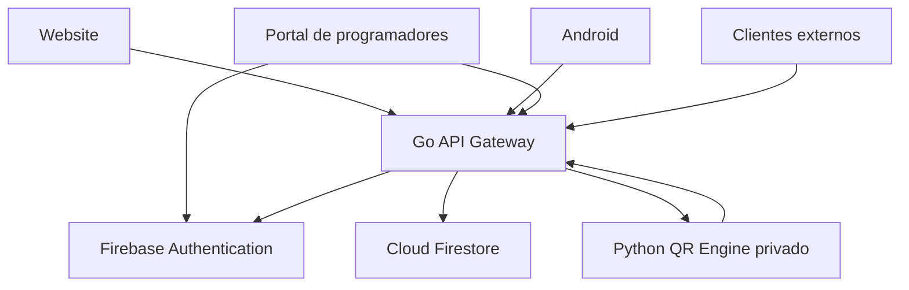

# QR Code Generator

> Plataforma gratuita de geração e personalização de códigos QR estáticos.

**Estado:** Planeamento inicial — pré-MVP. Este documento é provisório e será actualizado durante o desenvolvimento. Nenhum endpoint ou serviço descrito está ainda disponível.

## Visão

Disponibilizar um website, uma aplicação Android e uma API pública gratuita para gerar códigos QR personalizados. Os códigos incorporam directamente o conteúdo original, sem redireccionamentos proprietários, marcas de água ou expiração imposta pela plataforma. A validade de um URL depende do destino original, e o conteúdo de um código estático não pode ser alterado após a geração.

## Funcionalidades previstas

- [ ] URL, texto, Wi-Fi, vCard, email, SMS, telefone, WhatsApp e localização.
- [ ] Cores sólidas, gradientes, fundo transparente, formas dos módulos e dos olhos.
- [ ] Logótipos, molduras, legendas, margens e templates editáveis.
- [ ] Pré-visualização no servidor e exportação PNG e SVG.
- [ ] Validação de legibilidade e correspondência com o conteúdo original.
- [ ] Histórico local e partilha na aplicação Android.
- [ ] Portal de programadores, gestão de aplicações e credenciais.
- [ ] API REST versionada e documentação OpenAPI.

Fases posteriores: PDF, eventos de calendário, geração em lote e leitura de códigos QR.

## Arquitectura proposta



A geração ocorre exclusivamente no servidor. Go gere a API pública, autorização, quotas, concorrência e comunicação com o motor Python. Python gere codificação, desenho, exportação e validação dos QR Codes. O motor Python não será directamente exposto à Internet. A comunicação interna HTTP é uma proposta inicial.

### Tecnologias

| Componente | Tecnologia / situação |
|---|---|
| Gateway | Go, biblioteca net/http (proposta) |
| Motor QR | Python, FastAPI e bibliotecas de QR/imagem a validar |
| Identidade | Firebase Authentication — Google |
| Persistência | Cloud Firestore |
| Website e portal | Framework por decidir |
| Android | Tecnologia por decidir |
| Contratos | REST, JSON, OpenAPI |
| Infraestrutura | Docker e GitHub Actions (proposta) |

## Estrutura prevista do monorepo

```text
qrcode_generator/
├── apps/
│   ├── web/
│   ├── developers/
│   ├── android/
│   └── api/              # Gateway Go
├── packages/
│   ├── qr-engine/        # Serviço Python
│   ├── shared/           # Contratos e schemas
│   └── api-client/
├── tests/               # Integração e end-to-end
├── docs/
│   ├── architecture/
│   ├── api/
│   └── requirements/
├── infrastructure/
│   └── docker/
├── .github/workflows/
├── .gitignore
├── LICENSE
└── README.md
```

Esta estrutura é planeada; os directórios serão criados nas branches respectivas.

## API pública

Gratuita, documentada e acessível a programadores registados. O website público não exigirá conta. A aplicação oficial e o website usarão mecanismos próprios de protecção contra abuso, a definir. Endpoints propostos:

| Método | Endpoint | Finalidade |
|---|---|---|
| POST | `/api/v1/qr/generate` | Gerar imagem |
| POST | `/api/v1/qr/preview` | Pré-visualizar |
| POST | `/api/v1/qr/validate` | Validar imagem e conteúdo |
| GET | `/api/v1/types` | Tipos suportados |
| GET | `/api/v1/styles` | Estilos |
| GET | `/api/v1/formats` | Formatos |
| GET | `/api/v1/templates` | Templates |
| GET | `/api/v1/health` | Disponibilidade |
| GET/POST | `/api/v1/developer/apps` | Listar/criar aplicações |
| PATCH/DELETE | `/api/v1/developer/apps/{id}` | Actualizar/remover aplicação |
| POST | `/api/v1/developer/apps/{id}/keys` | Emitir credencial |
| DELETE | `/api/v1/developer/apps/{id}/keys/{keyId}` | Revogar credencial |

Exemplo conceptual, não executável enquanto a API não estiver publicada:

```http
POST /api/v1/qr/generate
Authorization: Bearer <API_KEY>
Content-Type: application/json
```

```json
{
  "type": "url",
  "content": "https://example.com",
  "format": "png",
  "size": 1024,
  "style": {
    "foreground": "#111827",
    "background": "#FFFFFF",
    "moduleShape": "rounded"
  },
  "errorCorrection": "H"
}
```

Resposta: imagem binária com Content-Type apropriado. Erros JSON estruturados com código estável e identificador do pedido. Estados previstos: 400, 401, 403, 413, 415, 422, 429, 500 e 503.

## Portal de programadores

Domínios ilustrativos: `qrcodegen.com`, `api.qrcodegen.com` e `devs.qrcodegen.com`. Disponibilidade e aquisição não confirmadas.

O programador inicia sessão com Google, regista uma aplicação, configura origens autorizadas, cria/roda/revoga credenciais e consulta utilização e quotas. O gateway valida o Firebase ID token nas operações de gestão, incluindo a propriedade da aplicação. Para consumo server-to-server, usa credenciais próprias e, opcionalmente, IPs permitidos. Para clientes web, CORS e allowlist de origens complementam a autenticação; não comprovam a identidade do cliente, pois Origin pode ser falsificado fora do navegador. Segredos de servidor nunca devem ser incorporados em JavaScript ou APKs. Integrações directas de browser/mobile exigirão um modelo específico de tokens temporários ou atestação, ainda por definir.

### Firestore — modelo conceptual

- `developers`: UID, perfil mínimo, timestamps.
- `applications`: proprietário, nome, tipo, origens/IPs permitidos, estado.
- `api_keys`: identificador, aplicação, hash seguro da credencial, validade, estado.
- `usage`: contadores agregados por aplicação e período.

Credenciais aleatórias de elevada entropia, apresentadas uma única vez e armazenadas apenas como hash/HMAC. Regras de acesso restritivas; operações privilegiadas pelo backend com IAM e validação de propriedade. Não guardar conteúdo de QR Codes ou logótipos após processamento.

## Segurança e concorrência

- HTTPS, validação de pedidos, limites de tamanho/resolução, rate limiting e quotas.
- CORS com origens exactas (esquema, host e porta); nunca usar CORS como autenticação.
- Goroutines, worker pools limitados, channels, context cancellation, timeouts e graceful shutdown.
- Backpressure no gateway e limites no motor Python; sem fila ilimitada.
- Logs sem credenciais, tokens, conteúdo de QR Codes ou palavras-passe Wi-Fi.
- Uploads de logótipos validados; sem download de URLs arbitrários.
- Zona livre mínima de quatro módulos, contraste e descodificação de teste antes da exportação.

## Internacionalização

Português como idioma inicial. Textos de interface em catálogos de tradução, por exemplo `locales/pt.json` e futuramente `locales/en.json`. Usar chaves estáveis, interpolação e formatação dependente do locale; evitar textos fixos em componentes. Identificadores de código, contratos e códigos de erro independentes do idioma. O conteúdo fornecido pelo utilizador nunca será traduzido automaticamente.

## Preparação do ambiente

Actualmente não existe uma implementação executável. Clonar o repositório:

```bash
git clone https://github.com/elrayn96/qrcode_generator.git
cd qrcode_generator
```

Pré-requisitos previstos: Git, Go, Python, Docker (opcional durante desenvolvimento) e projecto Firebase. Versões e comandos de instalação/execução serão documentados quando os módulos forem implementados. Credenciais privadas deverão estar em variáveis de ambiente ou secret managers, nunca no Git; disponibilizar exemplos sem segredos.

## Desenvolvimento e controlo de versões

`main` representa a linha estável. Criar branches curtas a partir de main para cada alteração, realizar commits atómicos, abrir pull requests, executar testes e integrar após revisão. Não usar uma branch permanente por aplicação.

| Prefixo | Exemplo |
|---|---|
| docs/ | `docs/initial-project-readme` |
| chore/ | `chore/monorepo-bootstrap` |
| feat/ | `feat/go-api-gateway` |
| fix/ | `fix/qr-logo-validation` |
| test/ | `test/gateway-concurrency` |
| refactor/ | `refactor/qr-renderer` |

Commits no estilo Conventional Commits: `docs: define initial project scope`, `feat(api): add health endpoint`. Tags semânticas após entregas estáveis, começando pela série 0.x.

## Testes e qualidade

Testes unitários Python e Go, integração gateway/motor/Firebase, testes de contrato OpenAPI, validação por descodificação, testes de autorização e quotas, concorrência e carga. Utilizar `go test -race ./...` no módulo Go e pytest no módulo Python quando existirem. CI deve bloquear integração perante falhas. Testar ainda responsividade, internacionalização e acessibilidade.

## Roadmap

1. Documentação, estrutura do monorepo e contratos.
2. Motor Python: QR básico, estilos e exportação.
3. Gateway Go: encaminhamento, concorrência e limites.
4. Firebase, credenciais e autorização.
5. Website responsivo e editor.
6. Portal de programadores e documentação pública.
7. Android, integração e publicação.

## Autor e direitos

Copyright © 2026 elrayn96. Todos os direitos reservados. Código publicamente visível não significa código aberto. Consultar [LICENSE](LICENSE). A utilização gratuita do serviço não constitui licença sobre o código-fonte. Dependências de terceiros mantêm as respectivas licenças.

Repositório: https://github.com/elrayn96/qrcode_generator
