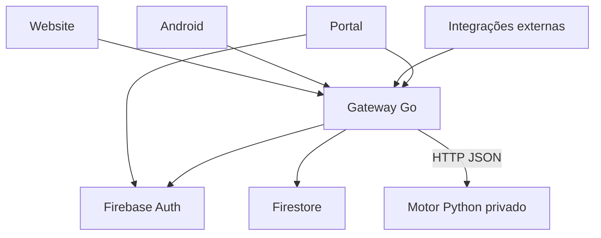

# Arquitectura do sistema

## Componentes

- Website e portal: HTML/CSS/JS puro, ES Modules, recursos locais.
- Android: Kotlin, Jetpack Compose, Material 3.
- Gateway Go: net/http, validação, autorização, filas, quotas, cache, encaminhamento.
- Motor Python: FastAPI, Uvicorn, Segno, Pillow; SVG com biblioteca padrão.
- Firebase Authentication e Firestore: identidade e metadados de aplicações.

## Limites e execução

Go é a única entrada da API. Python escuta em loopback no ambiente local; acesso interno autenticado quando separados por rede. Em produção futura, HTTPS e isolamento de rede obrigatórios. Android físico usa endereço LAN configurável, não localhost; HTTP de desenvolvimento apenas em configuração debug. Website e portal podem ser servidos pelo Go localmente. Firebase remoto requer Internet; adaptadores simulados permitem testes locais.

## Organização proposta

apps/{web,developer-portal,android}; services/{api-gateway,qr-engine}; packages/{design-tokens,api-contracts}; firebase/; docs/; tests/{integration,e2e,performance}; .github/workflows/. Confirmar estrutura existente antes de criar pastas. Sem Docker nesta fase.

## Fluxo de geração

Validar credencial e corpo, reservar quota, admitir trabalho na fila, gerar matriz Segno, renderizar com Pillow ou SVG, validar leitura, devolver ficheiro. Cancelamento propaga pelo contexto HTTP; trabalho CPU já iniciado pode continuar até terminar, devendo permanecer contabilizado na capacidade do motor.
