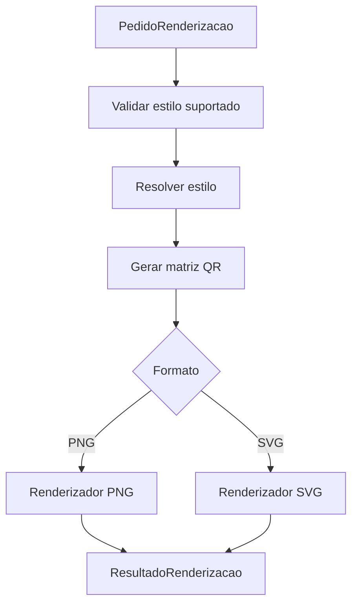

# Arquitectura de renderização do motor QR

## Responsabilidade e fluxo

O motor transforma conteúdo em matriz QR e aplica a personalização solicitada. Autenticação, quotas e administração pertencem ao gateway.

A função `renderizar` em `src/servicos/renderizacao.py` orquestra o processamento.

## Componentes

| Ficheiro | Responsabilidade |
|---|---|
| `motor/matriz.py` | Matriz imutável e tipos dos módulos |
| `renderizacao/geometria.py` | Escala, margens e posicionamento |
| `renderizacao/cores.py` | Conversão de cores |
| `renderizacao/formas.py` | Geometria das formas |
| `renderizacao/modulos.py` | Selecção de módulos |
| `renderizacao/olhos.py` | Geometria dos olhos |
| `renderizacao/olhos_png.py` | Olhos raster |
| `renderizacao/olhos_svg.py` | Olhos vectoriais |
| `renderizacao/gradientes.py` | Interpolação e geometria |
| `renderizacao/gradientes_svg.py` | Definições SVG |
| `renderizacao/preenchimentos.py` | Abstracção dos preenchimentos |
| `renderizacao/composicao.py` | Composição raster |
| `renderizacao/fundo.py` | Fundo |
| `renderizacao/estilos.py` | Resolução dos estilos |
| `renderizacao/png.py` | Exportação PNG |
| `renderizacao/svg.py` | Exportação SVG |
| `renderizacao/resultado.py` | Resultado binário |

## Matriz e geometria

Segno gera matrizes QR convencionais com versão e máscara automáticas, UTF-8 e ECI, respeitando o nível de correcção solicitado sem promoção automática. A dimensão é N = 21 + 4 × (V − 1), para versões 1 a 40. A escala inteira é floor(T / (N + 2 × M)), sendo T a resolução e M a margem em módulos. A matriz é centralizada; escalas inválidas são rejeitadas. Formas personalizadas sujeitas à validação exigem pelo menos quatro pixels por módulo.

## Personalização

- Formas: `square`, `rounded` (raio de 20% da escala), `dots` (diâmetro de 90%). Os padrões funcionais conservam a forma quadrada, excepto olhos explicitamente personalizados.
- Olhos: exterior 7 × 7, abertura 5 × 5 e interior 3 × 3 módulos; formas e preenchimentos independentes. A abertura mostra o fundo.
- Gradientes: lineares ou radiais, 2 a 8 pontos estritamente crescentes entre 0 e 1, ângulo linear de 0 a 360 graus, cores hexadecimais RGB/RGBA.
- Os módulos usam geometria global da matriz; olhos com gradiente explícito usam geometria local, e olhos com preenchimento herdado mantêm a geometria global.
- Módulos e olhos exigem opacidade. O fundo admite transparência e translucidez, com precedência: transparência explícita, gradiente, cor sólida, branco predefinido.

## PNG

A renderização segue a ordem fundo, módulos, olhos independentes quando necessários e exportação. Preenchimentos sólidos podem ser desenhados directamente; gradientes utilizam máscaras L sobre camadas RGBA. O alfa da camada é multiplicado pela intensidade da máscara e dividido por 255 antes da composição. Os olhos independentes utilizam camadas locais.

A composição regional determina a caixa delimitadora da máscara: máscara vazia não gera camada; caixa integral utiliza a composição completa; caixa parcial gera apenas a região necessária, preservando as coordenadas originais do gradiente.

## SVG

ElementTree constrói elementos vectoriais e caminhos compostos para os olhos. Gradientes são declarados em `defs`, com identificadores internos e `userSpaceOnUse`. Definições com geometria e propriedades iguais são reutilizadas. O fundo explicitamente transparente é omitido. O conteúdo QR não é inserido como texto ou XML executável.

## Optimizações e limites

A paleta de 4096 entradas é convertida em bytes RGBA. Deslocamentos são pré-calculados e dados construídos por linhas. A igualdade dos índices nos extremos permite reutilizar linhas ou cores. Gradientes radiais centrados exploram reflexão horizontal e vertical, inclusive em regiões parciais com centro coincidente. Regiões descentradas utilizam o cálculo geral.

A discretização PNG pode produzir diferenças relativamente à interpolação contínua, sobretudo com pontos muito próximos. SVG e PNG não são necessariamente idênticos pixel a pixel. Preservação geométrica e opacidade não garantem contraste nem legibilidade universal. Logótipos, molduras, legendas e endpoint interno permanecem pendentes.
